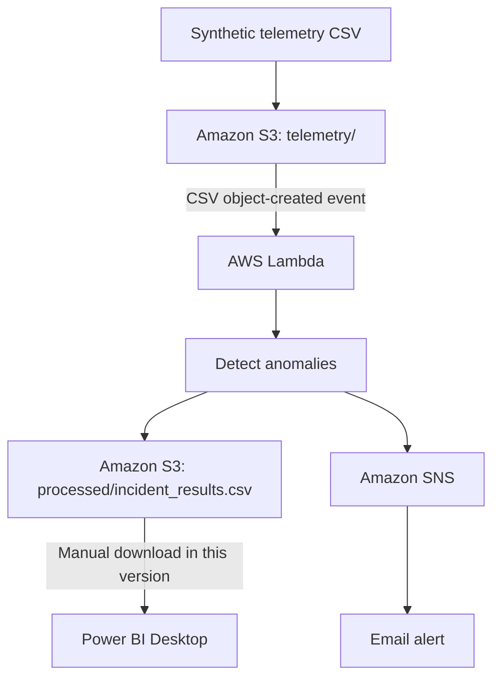

# Solar Asset Performance Monitoring & Incident Management

A personal cloud portfolio project demonstrating how synthetic solar-inverter telemetry can be processed with AWS, anomalies detected with Python, alerts sent by email, and results explored in Power BI.

> **Data and scope:** This is a learning/portfolio demonstration using synthetic data. It is not a production system and does not contain employer or client data.

## Architecture



## AWS services

- **Amazon S3:** Stores telemetry input and processed incident output.
- **AWS Lambda:** Reads the input CSV, applies detection rules, writes incident records, and publishes an SNS message.
- **Amazon SNS:** Sends an email summary when anomaly records are detected.
- **AWS IAM:** Grants the Lambda execution role least-privilege access to the required S3 objects and SNS topic.
- **Amazon CloudWatch Logs:** Stores execution logs for troubleshooting.
- **Power BI Desktop:** Visualizes the processed incident CSV.

## Detection rules

| Type | Illustrative condition | Severity |
|---|---|---|
| `ZERO_POWER` | Irradiance >= 200 W/m² and AC power <= 1 kW | HIGH |
| `HIGH_TEMPERATURE` | Inverter temperature >= 80°C | HIGH |
| `MISSING_TELEMETRY` | Gap between consecutive readings for an inverter > 5 minutes | MEDIUM |

These thresholds are for demonstration only. Real deployments need equipment-specific thresholds, operational validation, and safety review.

## Example test results

The current synthetic dataset previously produced 3,452 telemetry rows and 25 anomaly records:
- `ZERO_POWER`: 12
- `HIGH_TEMPERATURE`: 12
- `MISSING_TELEMETRY`: 1

These are anomaly records, not necessarily 25 unique real-world incidents. The current implementation rewrites the output CSV on each run and does not maintain a deduplicated incident history.

## Repository structure

```text
.
├── README.md
├── .gitignore
├── data/
│   └── README.md
├── scripts/
│   ├── generate_data.py
│   ├── validate_data.py
│   └── detect_incidents.py
├── aws/
│   ├── lambda/
│   │   ├── lambda_function.py
│   │   └── README.md
│   └── events/
│       └── s3_upload_test_event.json
└── reports/
    ├── README.md
    └── screenshots/
        └── README.md
```

Add your actual `data/solar_telemetry.csv`, generated incident CSV, Power BI PBIX, and screenshots only after checking them for sensitive information and file-size limits. GitHub browser uploads may not preserve empty folders; these README placeholders keep the intended structure visible.

## Run the local demo

Requires Python 3.10+ (the AWS Lambda example uses Python 3.12).

From the repository root:

```bash
python scripts/generate_data.py
python scripts/validate_data.py
python scripts/detect_incidents.py
```

Check the scripts' input/output paths before running. The scripts should be updated to use paths relative to the repository root if your local versions use absolute Windows paths.

## AWS workflow

1. Upload synthetic telemetry to a private S3 bucket under `telemetry/`.
2. Deploy `aws/lambda/lambda_function.py` to a Lambda function.
3. Configure least-privilege IAM permissions for S3 read, processed-output write, and SNS publish.
4. Set the Lambda environment variable `SNS_TOPIC_ARN` to your actual SNS topic ARN. Do not commit account-specific ARNs if you prefer to keep them private.
5. Configure an S3 ObjectCreated notification for the `telemetry/` prefix and `.csv` suffix.
6. Check CloudWatch Logs after a new upload.
7. Download `processed/incident_results.csv` and import it into Power BI Desktop.

The included Lambda example uses environment variables instead of hardcoding the bucket and SNS topic. Set `BUCKET_NAME`, `INPUT_KEY`, `OUTPUT_KEY`, and `SNS_TOPIC_ARN` in the Lambda configuration. The example expects the input key configured in `INPUT_KEY`; if you want to process uniquely named uploads, update the handler to read the S3 event's bucket and key instead of a fixed key.

## Power BI

The report can contain:
- Total anomaly records KPI
- High- and medium-severity KPIs
- Incident type and site charts
- Incident details table
- Site, severity, and date slicers

In the current version, the CSV is downloaded/imported manually. The report is not a live connection and does not automatically refresh when Lambda updates S3.

## Security and cost

- Keep S3 Block Public Access enabled.
- Never commit AWS access keys, secret keys, session tokens, `.env` files, or credentials.
- Do not publish sensitive screenshots, private email addresses, or employer/client data.
- Use least-privilege IAM policies.
- Check AWS billing and credits; services can incur charges depending on account terms and usage.
- Remove cloud resources you no longer need.

## Limitations and future improvements

- Add automated unit tests for anomaly rules.
- Add incident deduplication and persistent history.
- Detect missing readings at monitoring-window boundaries.
- Improve structured logging and error handling.
- Implement a secure Power BI refresh approach.
- Add deployment and resource-cleanup instructions.
- Validate all thresholds before any real-world use.

## Skills demonstrated

Python, CSV processing, anomaly detection, Amazon S3, AWS Lambda, Amazon SNS, IAM, CloudWatch Logs, Power BI, DAX, and cloud workflow design.
