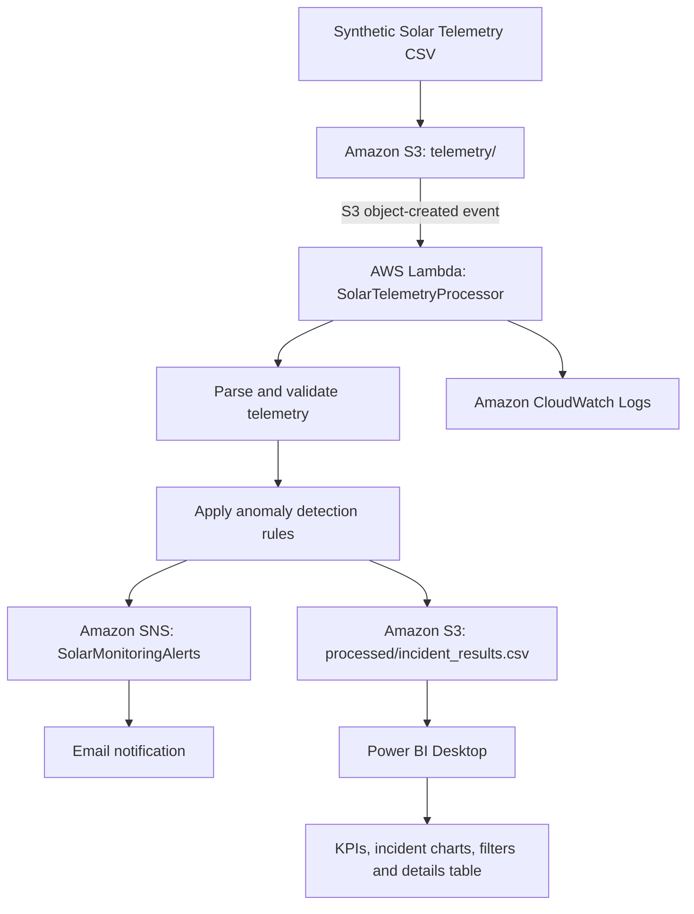

[README.md](https://github.com/user-attachments/files/33539480/README.md)
# Solar Asset Performance Monitoring & Incident Management System

<p align="center">
  <strong>AWS • Python • Amazon S3 • AWS Lambda • Amazon SNS • Power BI</strong>
</p>

## Overview

The **Solar Asset Performance Monitoring & Incident Management System** is a cloud-focused portfolio project that demonstrates how solar inverter telemetry can be collected as CSV data, analyzed for operational anomalies, and transformed into an incident register for reporting and alerting.

The solution combines Python-based data processing with AWS services and a Power BI dashboard. It is designed to demonstrate practical skills in serverless processing, object storage, event-driven workflows, monitoring, incident analysis, and business intelligence.

> **Project data:** This portfolio implementation uses synthetic solar telemetry. It is intended for learning and demonstration and does not contain employer or client operational data.

## Project Objectives

- Generate and validate structured solar telemetry data.
- Store telemetry and processing outputs in Amazon S3.
- Use AWS Lambda to process telemetry without managing servers.
- Detect potential zero-power, high-temperature, and missing-telemetry conditions.
- Save detected anomaly records as a CSV incident register.
- Send an email summary through Amazon SNS when anomalies are detected.
- Analyze incident patterns in Power BI using KPIs, charts, tables, and interactive filters.
- Demonstrate cloud security practices through scoped IAM permissions and private S3 storage.

## Solution Architecture



### Workflow

1. **Telemetry input:** Synthetic telemetry is generated as a CSV file.
2. **Object storage:** The input file is stored in a private S3 bucket under the `telemetry/` prefix.
3. **Event-driven processing:** An S3 object-created notification can invoke the Lambda function when a matching CSV object is uploaded.
4. **Data processing:** Lambda reads the configured CSV, parses timestamps and measurements, and evaluates anomaly rules.
5. **Incident output:** Detected anomaly records are written to `processed/incident_results.csv`.
6. **Alerting:** If anomaly records are detected and the SNS topic is configured, Lambda publishes a summary message to Amazon SNS.
7. **Observability:** Lambda execution information and diagnostic output are available in CloudWatch Logs.
8. **Reporting:** The processed CSV is imported into Power BI for incident analysis and visualization.

## Technology Stack

| Technology | Role in the project |
|---|---|
| Python | Synthetic data generation, validation, CSV processing, and anomaly detection |
| Amazon S3 | Storage for telemetry input and incident output |
| AWS Lambda | Serverless telemetry processing |
| Amazon SNS | Email notification delivery |
| AWS IAM | Access control for Lambda and AWS resources |
| Amazon CloudWatch Logs | Execution logs and troubleshooting |
| Microsoft Power BI Desktop | Dashboarding, KPI reporting, and interactive analysis |
| DAX | Measures for incident counts and severity analysis |
| CSV and JSON | Data exchange and sample event payloads |

## Repository Structure

```text
solar-asset-monitoring-system/
├── README.md
├── .gitignore
├── data/
│   └── solar_telemetry.csv
├── scripts/
│   ├── generate_data.py
│   ├── validate_data.py
│   └── detect_incidents.py
├── aws/
│   ├── lambda/
│   │   └── lambda_function.py
│   └── events/
│       └── s3_upload_test_event.json
├── reports/
│   ├── incident_register.csv
│   ├── Solar_Asset_Performance_Dashboard.pbix
│   └── screenshots/
│       ├── power_bi_dashboard.png
│       ├── lambda_execution.png
│       ├── s3_input.png
│       ├── s3_output.png
│       └── sns_alert.png
└── docs/
    └── architecture.md
```

Include the files that are actually present in your repository. The sample dataset, reports, and screenshots should contain synthetic or otherwise approved content only.

## Telemetry Data Model

The synthetic telemetry dataset uses fields such as:

| Field | Description |
|---|---|
| `timestamp` | Timestamp of a telemetry reading |
| `site_id` | Synthetic solar site identifier |
| `inverter_id` | Synthetic inverter identifier |
| `ac_power_kw` | AC power measurement in kilowatts |
| `dc_voltage_v` | DC voltage measurement in volts |
| `inverter_temp_c` | Inverter temperature in degrees Celsius |
| `ghi_w_m2` | Global horizontal irradiance in watts per square metre |
| `energy_kwh_interval` | Energy produced during the interval |
| `expected_scenario` | Scenario label used by the synthetic-data generator, when present |

The example dataset used during testing contained approximately **3,452 telemetry rows** across four synthetic sites and multiple inverters.

## Anomaly Detection Rules

The Lambda processing logic evaluates the following illustrative rules:

| Incident type | Detection condition | Severity |
|---|---|---|
| `ZERO_POWER` | Irradiance is at least 200 W/m² while AC power is at most 1 kW | HIGH |
| `HIGH_TEMPERATURE` | Inverter temperature is at least 80°C | HIGH |
| `MISSING_TELEMETRY` | The time gap between consecutive readings for the same site and inverter exceeds five minutes | MEDIUM |

These rules are demonstration thresholds. A real monitoring solution would need equipment-specific limits, time-window handling, false-positive evaluation, alert escalation, and validation with operational experts.

## Example Processing Results

A successful test run using the current synthetic dataset returned the following results:

| Metric | Result |
|---|---:|
| Telemetry rows processed | 3,452 |
| Total anomaly records detected | 25 |
| `ZERO_POWER` records | 12 |
| `HIGH_TEMPERATURE` records | 12 |
| `MISSING_TELEMETRY` records | 1 |

The counts describe **anomaly records**, not necessarily distinct or deduplicated operational incidents. The current workflow writes a new incident CSV on each execution rather than maintaining a historical incident database.

## AWS Implementation

### Amazon S3

The bucket stores the input and output objects using separate prefixes:

```text
telemetry/solar_telemetry.csv
processed/incident_results.csv
```

Keep S3 Block Public Access enabled. The input prefix is intended for telemetry uploads, while the output prefix stores the processed incident register.

### AWS Lambda

The `SolarTelemetryProcessor` function:

- Reads the configured input CSV from S3.
- Parses timestamps and numeric telemetry fields.
- Evaluates zero-power and high-temperature conditions.
- Detects gaps between consecutive readings per site and inverter.
- Writes the incident register to S3.
- Publishes a summary through SNS when anomaly records are present and the topic is configured.
- Writes diagnostic and execution output to CloudWatch Logs.

### Amazon SNS

The `SolarMonitoringAlerts` topic delivers an email summary to its confirmed subscription. The notification includes the number of telemetry rows processed and a breakdown of detected anomaly records.

### Amazon CloudWatch Logs

CloudWatch Logs can be used to review Lambda execution output, identify permission or configuration failures, and verify whether processing ran after an S3 upload.

### IAM and Security

The Lambda execution role should use least-privilege permissions for the required S3 read/write actions and SNS publishing. Resource ARNs should be scoped to the relevant bucket prefixes and topic where practical.

Do not place AWS access keys, secret keys, session tokens, or private credentials in source code or GitHub.

## Power BI Dashboard

The Power BI report, `Solar_Asset_Performance_Dashboard.pbix`, presents the incident register through:

- **Total Detected Anomalies** KPI
- **High Severity Incidents** KPI
- **Medium Severity Incidents** KPI
- Incident distribution by type
- Incident distribution by site
- Incident details table with timestamp, site, inverter, incident type, and severity
- Site slicer
- Severity slicer
- Date-range slicer

### Expected KPI values for the sample output

| KPI | Expected value |
|---|---:|
| Total anomaly records | 25 |
| High severity records | 24 |
| Medium severity records | 1 |

The dashboard filters were tested against the current sample incident CSV. In this implementation, the processed CSV is downloaded from S3 and imported into Power BI Desktop; the report does not automatically refresh when the S3 object changes.

## Run the Local Python Workflow

### Prerequisites

- Python 3 installed and available from the terminal.
- The repository cloned or downloaded locally.
- The project's Python scripts and data paths reviewed for your environment.

### Generate synthetic telemetry

From the repository root:

```bash
python scripts/generate_data.py
```

### Validate the dataset

```bash
python scripts/validate_data.py
```

### Detect incidents locally

```bash
python scripts/detect_incidents.py
```

Check the source files for the configured input and output paths before running. If the scripts use absolute Windows paths, update them to use paths relative to the project directory before sharing the repository.

## AWS Deployment Outline

1. Create a private S3 bucket and keep Block Public Access enabled.
2. Upload the synthetic telemetry CSV under the `telemetry/` prefix.
3. Deploy the Lambda processor using a supported Python runtime.
4. Configure environment variables for the bucket, input key, output key, and SNS topic ARN where the code expects them.
5. Attach a least-privilege execution role that permits reading the input object, writing the output object, and publishing to the selected SNS topic.
6. Create an SNS topic and confirm the email subscription.
7. Configure an S3 object-created notification for the intended `telemetry/` prefix and `.csv` suffix.
8. Test processing and review CloudWatch Logs.
9. Download the processed incident CSV and import it into Power BI Desktop.

Ensure the deployed handler is compatible with the event that invokes it. A handler that reads a fixed input key must be adapted if it is expected to process arbitrary uploaded filenames from S3 events. Avoid notification configurations that could cause output files to trigger the same function repeatedly.

AWS charges depend on account terms, credits, resource configuration, and usage. Review billing and remove unused resources.

## Security and Repository Hygiene

- Keep S3 buckets private.
- Never commit AWS credentials, secret keys, tokens, `.env` files, or local AWS credential files.
- Remove personal email addresses and sensitive account information from screenshots.
- Do not publish employer/client data or real operational telemetry.
- Review all files before committing them to a public repository.
- Use least-privilege IAM policies.
- Check AWS billing and clean up resources that are no longer needed.

## Current Scope and Future Enhancements

Potential future enhancements include:

- Automated unit tests for each anomaly rule.
- Incident deduplication and persistent historical storage.
- Detection of missing readings at the start and end of a monitoring window.
- More robust validation for malformed timestamps and numeric fields.
- Structured logging, retries, and clearer error handling.
- A secure automated refresh path for Power BI.
- A deployment guide, architecture diagram, and AWS resource-cleanup checklist.
- Threshold tuning and evaluation against real operational requirements before real-world use.

## Skills Demonstrated

Python, data validation, CSV processing, anomaly detection, AWS S3, AWS Lambda, Amazon SNS, IAM, CloudWatch Logs, event-driven architecture, Power BI, DAX, dashboard design, and technical documentation.

## Portfolio Summary

Built a cloud-based solar asset monitoring demonstration using synthetic telemetry. Implemented Python anomaly detection with AWS Lambda, stored incident results in Amazon S3, sent anomaly summaries through Amazon SNS, and developed a Power BI dashboard featuring severity KPIs, incident analysis, and interactive filters.
